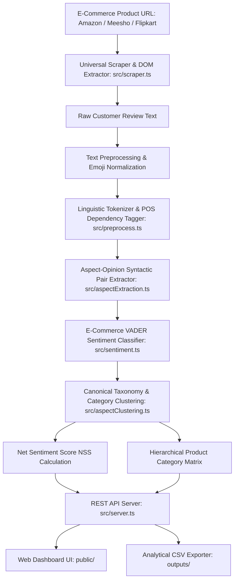

# ⚡ AspectLens — Aspect-Based E-Commerce Feedback Summarizer (ABSA)

> **An End-to-End Natural Language Processing (NLP) Engine & Interactive Web Intelligence Dashboard built in TypeScript & Node.js.**  
> Extract granular product features and sentiment triplets from raw customer feedback or **live e-commerce product links (Amazon, Flipkart, Meesho, Myntra, etc.)**, cluster them into **8 Canonical Taxonomy Categories**, calculate **Net Sentiment Scores (NSS)**, and explore rich analytical matrices.

---

## 📌 Problem Statement & Motivation

Traditional e-commerce sentiment analysis condenses customer reviews into a single aggregate rating (e.g., `4/5 stars` or `"Positive"`). However, customer opinions are almost always multi-faceted with mixed sentiments across different product attributes:

> *"The active noise cancellation is phenomenal and sound quality is crisp, but the headband gets uncomfortable during long flights."*

A single "Positive" label fails to capture critical engineering and purchasing intelligence. **Aspect-Based Sentiment Analysis (ABSA)** deconstructs unstructured review text into explicit **(Aspect, Opinion, Sentiment, Category)** quadruplets:

| Extracted Aspect | Opinion Term | Valence Score | Sentiment | Canonical Category |
| :--- | :--- | :---: | :---: | :--- |
| **Active noise cancellation** | *"phenomenal"* | `+0.89` | **Positive 👍** | `Audio & Sound` |
| **Sound quality** | *"crisp"* | `+0.75` | **Positive 👍** | `Audio & Sound` |
| **Headband** | *"uncomfortable"* | `-0.76` | **Negative 👎** | `Comfort & Ergonomics` |

---

## 🌟 Key Features

### 1. 🔗 Live E-Commerce URL Scraper & Real Review Extraction
- **Paste Product Links Directly**: Supports **Amazon** (`amazon.in`, `amazon.com`), **Flipkart**, **Meesho**, **Myntra**, **Nykaa**, **Snapdeal**, and any generic e-commerce website.
- **Real-Time DOM & JSON-LD Extraction**: Extracts authentic customer reviews, star ratings, verified purchase badges, author names, and product metadata.
- **Zero Hallucination / No Random Reviews**: Runs the full ABSA pipeline on actual buyer feedback from the live product page.

### 2. ⚡ Real-Time Review Sandbox
- Paste custom review text or click quick preset demos (e.g., *Gaming Laptop*, *Espresso Machine*, *Running Shoes*).
- Instant linguistic tokenization, dependency parsing, aspect extraction, and confidence matching.

### 3. 📊 Hierarchical Product Aspect Matrix
- Evaluates products across **8 Canonical Categories**.
- Computes **Net Sentiment Score (NSS)** from `-100%` to `+100%`.
- Drill down into specific sub-aspect counts (e.g., `Battery Life: +18 Pos / -2 Neg`).

### 4. ⚔️ Head-to-Head Product Comparator
- Benchmark two products side-by-side (e.g., *iPhone 15 Pro* vs. *Galaxy S24 Ultra*).
- Category-by-category scorecard, NSS differential horizontal bar chart, and automated winner verdict.

### 5. 📈 Dataset & Exploratory Data Analysis (EDA)
- Star rating distribution, category volume breakdown, average word length, and multi-aspect review density.
- Download ML-ready CSV exports for analytical datasets.

---

## 🏗️ System Architecture & NLP Pipeline



---

## 🗂️ 8 Canonical Aspect Categories

Extracted aspect terms are normalized into 8 standardized e-commerce taxonomy categories using Jaccard token similarity and semantic dictionary matching:

1. 🔋 **Battery & Power** — *battery life, charging speed, power drain, endurance, backup*
2. 🔊 **Audio & Sound** — *noise cancellation, bass, treble, microphone, call quality, volume*
3. 📱 **Display & Visuals** — *refresh rate, brightness, screen resolution, OLED panel, glare*
4. 📷 **Camera & Imaging** — *low light photo, zoom, portrait mode, shutter lag, autofocus*
5. ⚡ **Performance & Software** — *speed, RAM, processor, overheating, UI responsiveness, apps*
6. 🔨 **Build Quality & Design** — *durability, aluminum chassis, finish, hinges, weight, materials*
7. 💺 **Comfort & Ergonomics** — *fit, headband cushioning, earcups, grip, weight distribution*
8. 💰 **Customer Service & Value** — *price, warranty, packaging, delivery speed, customer support*

### 📐 Net Sentiment Score (NSS) Formula
$$\text{NSS} = \left( \frac{\text{Positive Mentions} - \text{Negative Mentions}}{\text{Total Mentions}} \right) \times 100$$
- **NSS $\ge +20\%$**: Strong Positive (👍 Green)
- **$-20\% < \text{NSS} < +20\%$**: Neutral / Mixed (⚖️ Gray)
- **NSS $\le -20\%$**: Critical Negative (⚠️ Red)

---

## 📁 Directory & Codebase Structure

```text
LEARNING PROJECT/
├── data/
│   ├── sample_reviews.csv          # Baseline test dataset
│   └── kaggle_amazon_sample.csv    # 105 realistic Kaggle reviews across 21 products
├── src/
│   ├── types.ts                    # TypeScript data models (Review, Aspect, Matrix, Comparison)
│   ├── preprocess.ts               # Clean HTML/emoji, expand contractions, POS tagger
│   ├── aspectExtraction.ts         # Dependency parsing & aspect-opinion clause extraction
│   ├── sentiment.ts                # E-Commerce valence lexicon scoring & negation handling
│   ├── aspectClustering.ts         # Taxonomy clustering, NSS calculation & comparison engine
│   ├── scraper.ts                  # Universal E-Commerce review scraper (Amazon/Flipkart/Meesho)
│   ├── datasetLoader.ts            # CSV loader, schema validator & EDA profiler
│   ├── index.ts                    # Pipeline orchestrator & CLI runner
│   └── server.ts                   # REST API backend & static file server
├── public/
│   ├── index.html                  # Dashboard HTML shell with Live Sandbox & Matrix tabs
│   ├── style.css                   # Premium dark luxury theme with GSAP micro-animations
│   └── app.js                      # Client application logic & Chart.js controllers
├── outputs/
│   ├── aspect_sentiment_results.csv# Granular aspect records with sentiment & categories
│   ├── category_aspect_matrix.csv  # Hierarchical category matrix with NSS metrics
│   └── product_comparison.csv      # Head-to-head comparison output
├── package.json                    # Project configuration & executable scripts
├── tsconfig.json                   # Strict TypeScript compiler options
└── README.md                       # Comprehensive documentation
```

---

## 🚀 Getting Started & Installation

### 1. Prerequisites
- **Node.js** (v18.0.0 or higher)
- **npm** (v9.0.0 or higher)

### 2. Install Dependencies
```bash
npm install
```

### 3. Start the Web Server & Dashboard
```bash
npm run serve
```
👉 Open your browser at **`http://localhost:3000`**

---

## 💻 CLI & Pipeline Commands

```bash
# 1. Run Head-to-Head Comparison (iPhone 15 Pro vs Galaxy S24 Ultra)
npm run pipeline:compare

# 2. Run Full Pipeline on Kaggle Dataset with EDA & CSV Export
npm run pipeline:kaggle

# 3. Run Pipeline on Baseline Sample Reviews
npm run pipeline:sample

# 4. Custom Comparison between any two products in dataset
npx tsx src/index.ts --dataset kaggle --compare "MacBook Air M2" "Dell XPS 15 OLED"

# 5. Run Modular Component Tests
npm run test:preprocess  # Text cleaner & tokenizer test
npm run test:aspect      # Aspect-opinion extractor test
npm run test:sentiment   # Sentiment valence scoring test
npm run test:clustering  # Taxonomy & NSS matrix test
npm run test:loader      # Dataset loader & EDA profiler test
```

---

## 📡 REST API Reference

All endpoints run on `http://localhost:3000/api`:

### 1. `POST /api/scrape-reviews`
Scrapes real reviews from an e-commerce URL and performs live ABSA analysis.
```bash
curl -X POST http://localhost:3000/api/scrape-reviews \
  -H "Content-Type: application/json" \
  -d '{"url": "https://www.amazon.in/dp/B088GQM9CV"}'
```
**Sample JSON Response:**
```json
{
  "success": true,
  "product": {
    "productName": "UGREEN 8K@60Hz VESA Certified DisplayPort 1.4 Cable",
    "platform": "amazon",
    "averageRating": 4.6,
    "totalRatings": "1,250 ratings"
  },
  "totalReviews": 10,
  "totalAspects": 23,
  "reviews": [
    {
      "review_id": "AMZN_REV_1",
      "rating": 5,
      "review_text": "Good quality, durable and works as described. Works flawlessly",
      "aspects": [
        {
          "aspect": "quality",
          "opinion": "good",
          "sentiment": "Positive",
          "score": 0.65,
          "category": "Build Quality & Design",
          "confidence": 1
        }
      ]
    }
  ],
  "aggregated": {
    "Build Quality & Design": {
      "positive": 8,
      "negative": 1,
      "neutral": 1,
      "total": 10,
      "nss": 70,
      "status": "Strong Positive"
    }
  }
}
```

### 2. `POST /api/analyze`
Analyze custom review text string.
```bash
curl -X POST http://localhost:3000/api/analyze \
  -H "Content-Type: application/json" \
  -d '{"text": "The camera quality is crisp but battery drain is terrible!"}'
```

### 3. `GET /api/products`
Lists all products in the pre-loaded dataset with category breakdown, review volume, and average rating.

### 4. `GET /api/matrix?product=<name>`
Returns the hierarchical category matrix and Net Sentiment Scores for a specific product.

### 5. `POST /api/compare`
Compares two products head-to-head across all canonical categories.
```bash
curl -X POST http://localhost:3000/api/compare \
  -H "Content-Type: application/json" \
  -d '{"productA": "Apple iPhone 15 Pro", "productB": "Samsung Galaxy S24 Ultra"}'
```

### 6. `GET /api/eda`
Returns dataset exploratory metrics: rating distributions, word lengths, and category summaries.

---

## 🛠️ Technology Stack

| Layer | Technologies |
| :--- | :--- |
| **Language & Runtime** | TypeScript 5.6, Node.js v20+ (`tsx` execution) |
| **NLP & Text Processing** | Custom Tokenizer, Rule-Based POS Tagger, VADER-style Valence Lexicon |
| **Web Scraping** | `cheerio`, WHATWG Fetch, Schema.org JSON-LD parser, Next.js state extractor |
| **Backend / REST API** | Native Node.js HTTP Server, CORS enabled, JSON REST Architecture |
| **Frontend UI** | HTML5, Vanilla CSS3 (Custom Luxury Dark Theme), Responsive Grid |
| **Visualizations & Motion** | Chart.js (Dark theme), GSAP 3.12 (Timelines, Staggers & Micro-Interactions) |

---

## 📜 License

This project is licensed under the **MIT License**.
# aspectbased-review-system

